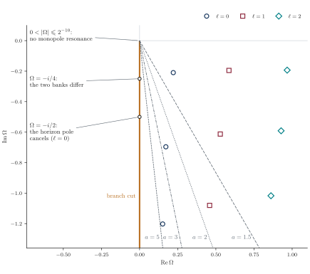

<!-- Authors: Davide Batic, Dr. Denys Dutykh (Mathematics Department, Khalifa University of Science and Technology, Abu Dhabi, UAE) and Alexandre Grezzi de Miranda Schmidt (Departamento de Física, Instituto de Ciências Exatas, Universidade Federal Fluminense, Volta Redonda, Brazil) -->

# A confluent Heun connection formula for Schwarzschild quasinormal frequencies: codes and data

Davide Batic¹, Denys Dutykh¹ and Alexandre Grezzi de Miranda Schmidt²

¹ Mathematics Department, Khalifa University of Science and Technology, PO Box 127788, Abu Dhabi, United Arab Emirates<br>
² Departamento de Física, Instituto de Ciências Exatas, Universidade Federal Fluminense, Volta Redonda, RJ, Brazil



The complex plane of the dimensionless frequency Ω = 2Mω. The nine markers are the scalar quasinormal frequencies isolated in the article, for ℓ = 0, 1, 2 and, in each column, the overtones n = 0, 1, 2 from top to bottom. Each of them is proved to be the only zero of the incoming amplitude in a disk of radius 10⁻⁴, far smaller than its marker. The amplitude is computed along an upward ray z = a + is of the complex radial plane, and the outgoing wave decays along that ray to the right of the line marked a, on which −Im Ω = 2√(a(a − 1)) Re Ω. Each frequency lies to the right of the line of the anchor used for it: a = 1.5 for six of them, a = 2 for the second overtone of ℓ = 1, and a = 3 and a = 5 for the first and second overtones of the monopole. On the negative imaginary axis, the branch cut, the monopole amplitudes of its two banks differ at Ω = −i/4, and at Ω = −i/2 the pole of the unit horizon normalisation cancels in the monopole Green kernel. The punctured half-disk 0 < |Ω| ⩽ 2⁻¹⁰, Im Ω ⩽ 0, free of monopole resonances, is too small to be drawn.

This repository accompanies the article *A confluent Heun connection formula for isolating scalar quasinormal frequencies in Schwarzschild spacetime*. It holds the programs that enclose the incoming amplitude in outward-rounded interval arithmetic, the stored enclosures on which the proofs of the article rest, the independent numerical calculations that identify the modes, and the checks that replay all of them.

## The article

A massless scalar field of frequency ω outside a Schwarzschild black hole of mass M, with time dependence e^(−iωt), obeys the radial equation

```text
u_xx + (Ω² − U) u = 0,        U = (1 − 1/z) (L/z² + 1/z³),

z = r/(2M),    Ω = 2Mω,    x = z + log(z − 1),    L = ℓ(ℓ + 1).
```

The solution that is purely ingoing at the horizon, with unit amplitude there, decomposes at infinity as

```text
u_H = A_out u₊ + A_in u₋,        u± ~ e^(±iΩx)   as   x → +∞,
```

and a quasinormal frequency is a zero of the incoming amplitude A_in on its physical continuation into the damped half-plane. The article writes A_in as a connection coefficient of the confluent Heun equation, reached by the gauge u = e^(iΩz) z (z − 1)^(−iΩ) H, and evaluates it at the point z_R = a + iR of an upward ray from the truncated inverse-power expansion P_N of the outgoing solution. The error of this approximation A_N is given exactly by the residual R_N of P_N in the equation of the outgoing factor,

```text
                          a + i∞
A_in − A_N(z_R)  =  1/(2iΩ)  ∫     h(t) R_N(t) dt,        R_N = c_N z^(−N−2) + d_N z^(−N−3),
                          z_R
```

where h = e^(iΩx) u_H is the horizon solution with its oscillation removed. The identity does not ask the inverse-power series to converge. Bounding its right-hand side, and the transport of the horizon data to z_R, in outward-rounded arithmetic, and comparing the amplitude with its linear Taylor term by Rouché's theorem, the article proves that each open disk |Ω − c_ℓn| < 10⁻²⁸ about the nine centres below contains exactly one zero of A_in, a simple one. The same zero is the only one in the closed disk of radius 10⁻⁴, throughout which |A_in′| > 2.04879. The index n labels the nearby mode of Leaver's continued fraction, computed independently; counting the zeros between the disks remains open.

| ℓ | n | Re c_ℓn | Im c_ℓn |
|:-:|:-:|--:|--:|
| 0 | 0 | `0.220909878160839371750923012336` | `−0.209791434173761917563478133711` |
| 0 | 1 | `0.172233836672798344939925390787` | `−0.696104893612920991050153640965` |
| 0 | 2 | `0.151483871070351525940443288239` | `−1.202157180071607028187312037419` |
| 1 | 0 | `0.585872266534565417244491491108` | `−0.195319977827156444311113978345` |
| 1 | 1 | `0.528897301209665079267177324478` | `−0.612514783118094246451411572602` |
| 1 | 2 | `0.459078669862603343695496136573` | `−1.080266850038214426940243559470` |
| 2 | 0 | `0.967287744421425973455558870304` | `−0.193517551956575725317307466702` |
| 2 | 1 | `0.927701158039531126436544113024` | `−0.591207873975925052419212578699` |
| 2 | 2 | `0.861088108753151536213124505866` | `−1.017116804308548974940009868965` |

The displayed decimals are the exact rational centres. The residual also gives a first correction to A_N at no extra cost in R or N: at the centre c₀₀ of the fundamental monopole and at (R, N) = (40, 22), it reduces the error of the amplitude by a factor greater than 41000. On the negative imaginary axis, the monopole amplitude takes different values on the two banks of the cut at Ω = −i/4, and the simple pole that the unit horizon normalisation acquires at Ω = −i/2 cancels in the monopole Green kernel on both banks. No monopole resonance lies in the punctured half-disk 0 < |Ω| ⩽ 2⁻¹⁰, Im Ω ⩽ 0, both banks of the cut included. For the general confluent Heun equation, the connection coefficient is enclosed at two complex parameter sets, its phase agrees with Schultze's recurrence, and in one family a simple zero in the resolved accessory parameter continues analytically through an apparent singularity, on the whole interval 0 ⩽ ε ⩽ 10⁻³.

## How to cite

The article that these codes and data accompany, "A confluent Heun connection formula for isolating scalar quasinormal frequencies in Schwarzschild spacetime", by D. Batic, D. Dutykh and A. Grezzi de Miranda Schmidt, has not been published yet. Until it is, please cite the software:

```text
D. Batic, D. Dutykh and A. Grezzi de Miranda Schmidt, confluent-heun-schwarzschild-qnms: codes and
data of a confluent Heun connection formula for Schwarzschild quasinormal frequencies, software,
version 1.0.0 (2026).
```

https://github.com/dutykh/confluent-heun-schwarzschild-qnms

The file `CITATION.cff` gives the same reference to the button *Cite this repository* of GitHub.

## Contents

The folder `cert/` holds the programs of the proofs and their stored records. The module `elementary.py` encloses the elementary functions with outward rounding, through the interval libraries MPFI and MPFR; `transport.py` encloses the horizon solution, first by its Frobenius series with a geometric majorant for the omitted terms, then by Taylor steps whose Cauchy remainders enter each enclosure; `amplitude.py` encloses the incoming amplitude with its residual bound, and `quadrature.py` the integrals of the first correction. The module `campaign.py` computes the enclosures at the nine centres and at the shifted points, `isolate.py` and `check.py` turn them into the Rouché comparisons in exact rational arithmetic, `compare.py` encloses the true errors at a fixed matching point, `neighborhoods.py` gives the interpolation bounds on the larger disks, and `reproduce.py` runs the whole scalar calculation. The modules `lateral.py`, `threshold.py`, `resonant_horizon.py`, `resonant.py` and `generic.py` treat the two banks of the cut, the threshold half-disk, the horizon solutions at the resonant frequencies Ω = −im/2, the accessory brackets and the two complex parameter sets of the general equation. Their records are the files `cert/results*.json` and the folder `cert/results/`, which holds, for each mode, the enclosures at the centre and at the two shifted points and the disk comparison. The files `cert/test_*.py` are their regression tests, and `cert/verify.py` is the driver of the checks below.

The folder `analysis/` holds the numerical calculations that are not part of the proofs: Leaver's continued fraction, contour integrals in double and multiple precision, Chebyshev collocation up to degree 640, the forward root searches, the adaptive choice of the matching point and the truncation order, the first residual correction, and the forward and backward evaluations of the general equation, each with its stored results and its notes. The folder `research/` holds the comparison with Schultze's recurrence (`check_schultze.py`, with its record `schultze_comparison.json`), the exact identities of the accessory strip (`check_accessory_strip.py`), the elementary example that fixes the phase (`check_schultze_phase.py`), and notes on the literature. The folder `verification/` holds symbolic checks of the scalar equations, `reports/` the software environment of the historical floating-point runs and the description of the earlier scalar benchmark, and `docs/figures/` the figure above with the program that draws it.

The file `NUMERICAL_SHA256.txt` lists the SHA-256 digest of every file of `analysis/`, `cert/`, `research/` and `verification/` and of `requirements.txt`, and `NUMERICAL_SHA256.sha256` gives the digest of that list; `MANIFEST_SHA256.txt` covers the whole repository.

## Requirements

The programs run on Linux x86-64 with the LP64 data model. They were tested with Python 3.12.14 and 3.14.4, mpmath 1.3.0, NumPy 2.3.5, SciPy 1.17.0 and 1.16.3, and SymPy 1.14.0, the versions pinned in `requirements.txt`. The interval arithmetic calls the system libraries MPFI 1.5.4, MPFR 4.2.2 and GMP 6.3.0, which the Python packages do not install; on Debian and Ubuntu they come with the first command below. The last command checks the interval layer.

```sh
sudo apt install libmpfi0 libmpfr6 libgmp10
python3 -m venv ~/.venvs/heun
. ~/.venvs/heun/bin/activate
python -m pip install -r requirements.txt
python -B -m cert.elementary
```

All commands start at the root of the repository.

## Checking the results

```sh
sha256sum -c MANIFEST_SHA256.txt
python -B -m cert.verify --check-saved
python -B -m cert.verify --full --workers 3
```

The first command checks that every file is intact. The second takes about a second and writes nothing. It checks the digests of the 153 numerical files; the nine Rouché inequalities, recomputed in exact rational arithmetic from the stored enclosures; the comparisons of the errors at a fixed matching point; the interpolation bounds of the larger disks; the inequalities of the threshold half-disk, of the two banks of the cut, of the regularized horizon solutions and of the accessory brackets; the 68 Chebyshev roots and the nine comparisons with the continued fraction and the contour integrals; the identities of the accessory strip and of the phase example; and Schultze's recurrence replayed to k = 4096.

The third command takes about two minutes with three workers. In a temporary folder it computes again the 27 enclosures at the centres and the shifted points, the three controls at a fixed matching point, the 72 interpolation samples, the rectangles of the general equation, the two lateral continuations, the threshold, the horizon solutions and the accessory brackets. It runs the regression tests of the transport, the quadrature, the isolation, the larger disks and the two banks, and requires that all 49 regenerated records agree exactly with the stored ones once their fields of elapsed time are set aside. It finally replays Schultze's recurrence to k = 131072. A failed check stops with a nonzero exit status.

The check of the printed tables, `cert/check_tables.py`, reads the source of the article at `reports/Confluent_Heun_Generic_Progress.tex`. This repository does not carry the article, and both commands then report that this check is skipped.

## Where each result of the article comes from

| Result of the article | Record |
|---|---|
| The nine centres c_ℓn | `cert/campaign.py` and the field `omega_exact` of `cert/results/*_center.json` |
| The Rouché comparisons on the circles of radius 10⁻²⁸ | `cert/results/*_disk.json` |
| The bounds on the disks of radius 10⁻⁴ | `cert/neighborhood_samples.json` and `cert/results_neighborhoods.json` |
| The error ratios of the first correction at c₀₀ | `cert/results/00_fixed_endpoint_errors.json` |
| The first correction at the continued-fraction frequency | `analysis/qnm_free_correction_results.json` |
| The forward root searches | `analysis/qnm_forward_coefficient_results.json` |
| The adaptive choice of (R, N) | `analysis/qnm_tail_optimization_results.json` |
| The two complex parameter sets of the general equation | `cert/results_generic.json` |
| The accessory brackets | `cert/results_resonant.json` |
| The monopole on the two banks of the cut | `cert/results_lateral.json` |
| The threshold half-disk | `cert/results_threshold.json` |
| The regularized horizon solutions at Ω = −im/2 | `cert/results_resonant_horizon.json` |
| The convergence of Schultze's recurrence | `research/schultze_comparison.json` |

## The independent calculations

The programs of `analysis/` write their results into that folder, so they are best run in a copy of the repository. Set `OPENBLAS_NUM_THREADS=1` for the Chebyshev calculations.

```sh
python analysis/qnm_leaver.py
python analysis/qnm_contour.py --campaign
python analysis/qnm_contour_mp.py --campaign
python analysis/qnm_contour_mp_overtone_run.py
python analysis/qnm_horizon_regularized.py --test
python analysis/qnm_scattering_checks.py
python verification/scalar_resonance_verify.py
python analysis/qnm_tail_optimization.py
python analysis/qnm_tail_optimization_followup.py
python analysis/qnm_tail_optimization_global_update.py
python analysis/qnm_forward_coefficient.py
python analysis/qnm_forward_coefficient_comparisons.py
python analysis/qnm_free_correction.py
python analysis/generic_che_resonance_verify.py
python analysis/generic_che_path_verify.py
python analysis/generic_che_infinity_numeric.py --campaign
python analysis/generic_che_forward_numeric.py
python analysis/generic_che_resonant_zero.py
```

The Chebyshev calculation can also be replayed into a separate folder and compared with the stored records:

```sh
che_replay=$(mktemp -d)
OPENBLAS_NUM_THREADS=1 python -B analysis/qnm_spectral_release.py --recompute "$che_replay/spectral.json"
python -B analysis/qnm_spectral_release.py --check-result "$che_replay/spectral.json"
python -B analysis/qnm_compare.py --spectral "$che_replay/spectral.json" --output-dir "$che_replay"
cmp "$che_replay/qnm_comparison_results.json" analysis/qnm_comparison_results.json
```

It follows the nine branches through the degrees 40, 60, 80, 100, 160, 240 and 320, and the monopole overtones on to 400, 480 and 640. The comparison with the stored records is strict and includes the Newton histories, which start from a double-precision eigensolver and change with the machine: on another machine the 68 frequencies agree while some of these histories differ. The ratios of the analytic bounds in the last column of the table of the first correction are stored in `analysis/qnm_free_correction_results.json` and are not rewritten by `analysis/qnm_free_correction.py`. Times recorded in the stored results are single measurements and change from run to run.

## Licence

The codes and data are distributed under the GNU Lesser General Public License, version 2.1, given in `LICENSE`.
